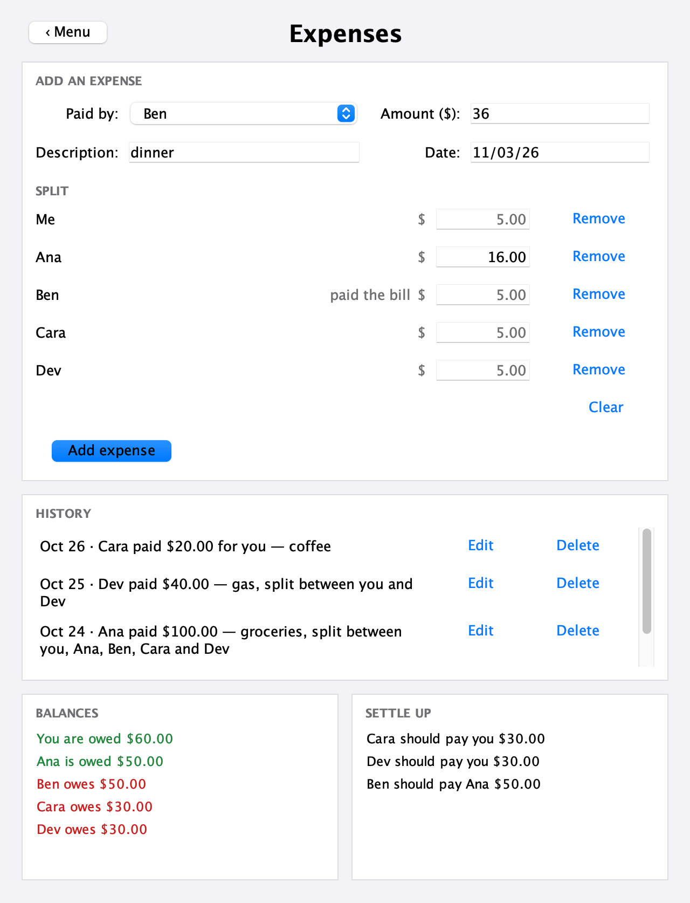

# TabSplit

A desktop app for keeping a shared tab with friends (a trip, a house, a semester) and settling
it with the **fewest possible payments**.

TabSplit only records expenses; it never moves money. Add who paid and how it was split, and it
keeps everyone's balance and tells you exactly who should pay whom.



## Features
- **Split evenly or by exact amounts.** Type in anyone's share and the rest is split evenly
  between everyone else, like Venmo. Leave people out of an expense with one click.
- **Fewest payments to settle.** Finds the true minimum number of payments, not just a good
  guess (see [how it works](#how-settle-up-works)).
- **History with dates.** Edit or delete any expense; balances update on their own.
- **Saves automatically** after every change, to `~/.tabsplit/group.json`.
- **Exact money.** Amounts are stored as whole cents, so no floating-point rounding errors.
- Add, rename and remove people (up to 10), with clear messages instead of crashes.

## Run it
You need Java 17 or newer.

```bash
./gradlew run
```

Run the tests:

```bash
./gradlew test
```

## How settle-up works
Everyone's balance is what they paid minus their shares. Settling up means making every balance
zero with as few payments as possible.

The common approach is greedy: repeatedly have the person who owes the most pay the person
who's owed the most. It always finishes in at most *n − 1* payments, but not always the fewest.
The group in the screenshot shows why. Balances are **+$60, +$50, −$50, −$30, −$30**:

| Greedy (4 payments) | TabSplit (3 payments) |
|---|---|
| Ben pays you $50 | Ben pays Ana $50 |
| Cara pays Ana $30 | Cara pays you $30 |
| Dev pays Ana $20 | Dev pays you $30 |
| Dev pays you $10 | |

The key idea: a group of *k* people whose balances add up to zero can always settle among
themselves in *k − 1* payments. So the fewest payments overall is

> (people with a nonzero balance) − (the most zero-sum groups they can be split into)

Here, {Ana, Ben} and {you, Cara, Dev} each add up to zero: 5 people − 2 groups = 3 payments.

Finding the most zero-sum groups is NP-hard in general, but a group is capped at 10 people, so
TabSplit checks every subset with a bitmask dynamic program: for each subset of people, the most
zero-sum groups it can be split into. That's 2¹⁰ subsets × 10 people, about 10,000 steps.
It then settles each group with the greedy match, which takes *k − 1* payments for a group of
*k*, the fewest possible for a group that can't be split any further.
See `UserGraph.settleUp()`.

## Design decisions
- **Money in whole cents (`long`), never `double`.** With floating point, 0.1 + 0.2 − 0.3 isn't
  0, and those leftovers used to show up as "$0.00" payments.
- **A list of expenses is the single source of truth.** The first version kept a who-owes-whom
  matrix of running totals, which can't edit or delete one expense. Now every expense is stored
  and balances are worked out from the list. Recomputing is trivial at 10 people.
- **The save file has its own format,** separate from the code's classes, with a version number.
  Saves write a temp file and swap it in, so a crash can't leave half a file; a damaged file is
  kept as `group.json.bad` rather than overwritten.
- **Recording only.** The value is adding up a long-running tab and settling it all at once,
  not tracking payments person by person.

## Project layout
| File | What it does |
|---|---|
| `src/UserGraph.java` | The group: people, expenses, balances, splitting and settle-up |
| `src/Expense.java` | One expense: who paid, who shares it, each share, description, date |
| `src/GroupStore.java` | Saves the group to JSON and loads it back |
| `src/Expenses.java`, `src/FriendsTab.java` | The two screens (Swing) |
| `test/TabSplitTest.java` | 39 JUnit tests: splitting, settle-up, editing, dates, saving |

## History
TabSplit started in 2024 as a data structures project at Macalester College by Vin Leang,
Isauro Reyes and Harold Ponce Saldivar, focused on the settle-up logic. In 2026 Vin rebuilt it
as a full app: moved it to Java Swing, made the settle-up exact, and added splits, editing,
dates, saving to memory, and general UI upgrades.
